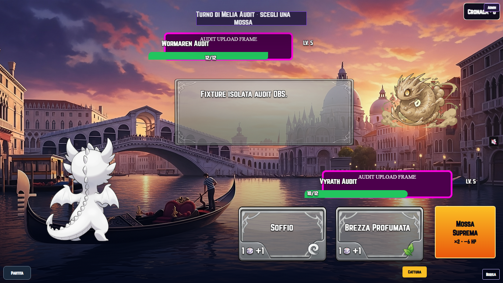
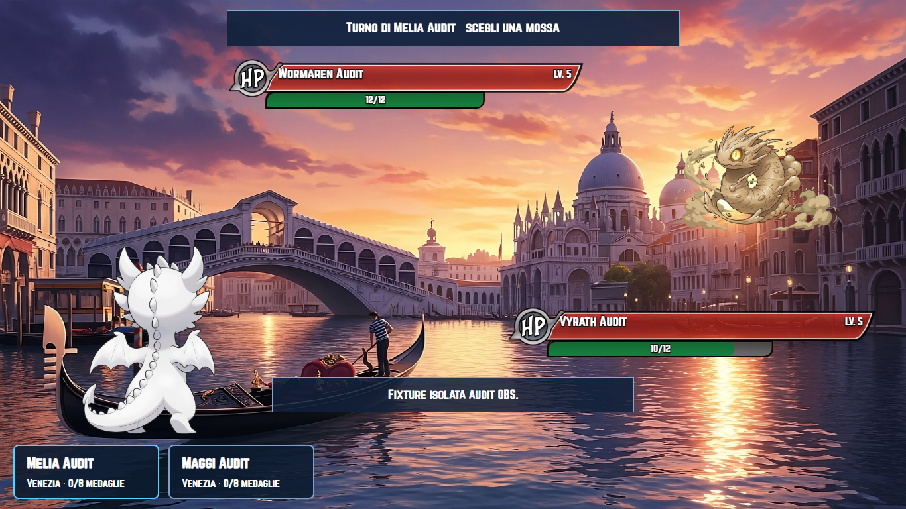

# Audit del progetto Arkamon — 29–30 ottobre 2026

**Aggiornamento del 30 ottobre: i nove difetti e la lacuna CI rilevati da questo audit sono stati corretti e verificati in locale.** Il [rapporto delle correzioni](../fixes-2026-10-30/README.md) e il [riepilogo delle verifiche](../fixes-2026-10-30/verification.json) descrivono lo stato attuale. Le sezioni seguenti conservano i rilievi e le prove al momento della scoperta.

## Perimetro e stato

Checkout analizzato: `C:/Users/andre/Documents/Codex/2026-10-19/https-github-com-andreatz-arkamon-beta/checkout`, HEAD `bb142c1b`. Comprende l'importazione completa delle 110 forme / 550 clip e gli interventi strutturali precedenti ancora locali. I risultati riguardano questo insieme effettivamente presente, non soltanto il contenuto di HEAD o il sito pubblicato.

Analisi in lettura di gameplay, store e policy, progressione, dati e riferimenti, salvataggi/backup/recupero, progetti visivi e Studio, UI/navigazione, animazioni/VFX/audio, pubblico/regia/ospite, confezionamento web/desktop e workflow. La ricognizione iniziale censisce 671 file non JSON nei percorsi `src`, `scripts`, `e2e`, `tests` e nelle tre suite compilate/desktop. Include test e codice generato: non equivale alla lettura manuale di ogni riga o a una campagna giocata in ogni possibile sequenza.

Sono stati riprodotti **nove difetti**, uno P1, sei P2 e due P3, oltre a **una lacuna nel gate di rilascio**. P1 indica la perdita durevole di progressi da correggere per prima; P2 un errore concreto in condizioni specifiche; P3 un difetto circoscritto di interazione. Le condizioni e i confini delle prove sono indicati per ciascuno. Non sono state modificate le regole, le illustrazioni, i salvataggi reali, i sorgenti o i test del prodotto. Questo audit crea soltanto documentazione ed evidenze; nessun commit, push, deploy o installazione desktop.

**Collaudo generale browser concluso il 30 ottobre:** 520 identità riconciliate, **410 casi passati e 110 esclusioni intenzionali**, zero casi irrisolti o non eseguiti. Due scenari sono passati al ricontrollo dopo errori di rete/sospensione; i fallimenti precedenti restano nello storico. I nove difetti seguenti sono stati riprodotti con prove mirate aggiuntive e restano da correggere.

## Difetti confermati

| ID | Priorità | Problema e impatto | Evidenza |
|---|---|---|---|
| GAME-29-01 | P1 | «Prosegui» può perdere livelli e HP di un compagno e lasciare tutta la squadra KO dopo una vittoria. La squadra finale è valida, ma gli aggiornamenti singoli vengono confrontati con un roster parzialmente vecchio. | Motore/store e click Prosegui reale, con reload prima e dopo; [gameplay](gameplay.md). |
| SAVE-29-01 | P2 | Il backup esportato può superare il limite del proprio importatore pur contenendo una campagna supportata. La copia scaricata non è ripristinabile. | 20 replay / 4.800 eventi: 8.013.253 byte esportati respinti, identici dati compatti 4.519.366 byte accettati; [prova](evidence/backup-roundtrip.json). |
| VISUAL-29-01 | P2 | Recuperare un journal visivo può sovrascrivere un tema salvato successivamente, poi cancellare il journal dichiarando successo. | Entrambi i rami, rollback e completamento, su storage in memoria; [prova](evidence/visual-journal.json). |
| VISUAL-29-02 | P2 | Una sola bozza visiva corrotta rende vuoti anche progetto applicato e ripristino validi. Il successivo salvataggio della bozza li elimina definitivamente. | Lettura e stage dei moduli reali; [prova](evidence/project-history.json). |
| STUDIO-29-01 | P3 | Un'importazione lenta termina dopo «Scarta» e rimette la bozza che l'utente aveva appena abbandonato. Il layout applicato resta intatto fino a un nuovo Applica. | Input file e pulsante reali, lettura ritardata in un contesto isolato; [prova](evidence/studio-import-race.json). |
| OBS-29-01 | P2 | Le cornici HP importate nello Studio non arrivano al visualizzatore con profilo separato: il relay trasmette un ID IndexedDB privato della console. | Importazione reale, due contesti e relay reale; confronto visivo sotto, [runtime](runtime.md). |
| OBS-29-02 | P2 | Console e regia possono usare velocità diverse per la stessa animazione. Lo snapshot non trasmette la velocità e il viewer usa le sue preferenze locali. | Renderer reale a 48 FPS nella console fast e 24 nel viewer normal; il campione temporale sotto carico non certifica un rapporto fisico 2:1; [runtime](runtime.md). |
| RELEASE-29-01 | P2 | Un `VITE_MEDIA_REVISION` incoerente con il pin viene accettato dal confezionamento completo. La build può riuscire con URL che puntano a una revisione priva dei media. | Fixture completa delle cinque azioni, `requireComplete=true`, pin `aaaa…` e revisione richiesta `bbbb…` accettati; [runtime](runtime.md). |
| UI-29-01 | P3 | Il focus trap del dialogo ignora il `tabIndex=-1` delle griglie con navigazione a frecce. Tab attraversa anche i posti che il componente ha escluso dalla sequenza, rendendo la navigazione incoerente. | Dal primo riquadro del menù, Tab porta a «Apri Arkadex» con `tabIndex=-1`; [prova](evidence/keyboard-roving.json). Non è una dichiarazione di violazione WCAG rilevata da Axe. |

I problemi di perdita dello storico visivo riguardano personalizzazioni e punti di ripristino del progetto grafico, non l'intera campagna. Il P1 riguarda invece i dati dei compagni nella campagna.

## P1: chiusura di una battaglia con squadra finale valida

Il loop in `src/scenes/BattagliaScene.tsx:833` chiama `aggiornaPokemon` una volta per membro. Il controllo a `src/store/gameStore.ts:525` verifica ogni proposta contro gli altri membri non ancora aggiornati. La transazione esterna raggruppa la scrittura, ma non rende atomica questa decisione di dominio.

Sequenza raggiungibile in una battaglia NPC con più avversari:

1. Squadra iniziale in ordine `[A livello 10 KO, B livello 5 vivo]`; entra B, il primo vivo.
2. B ottiene un KO e sale a 6; viene rianimato A; B cade.
3. A entra, ottiene un KO e sale a 11. La squadra finale `[11, 6]` ha differenza cinque ed è valida.
4. «Prosegui» propone prima A11 contro B5 ancora nel roster della campagna: l'aggiornamento è respinto. B6 viene poi accettato.

| Momento | A | B |
|---|---|---|
| Checkpoint concluso prima di Prosegui | Livello 11, 11 HP | Livello 6, 0 HP |
| Dopo Prosegui | **Livello 10, 0 HP** | Livello 6, 0 HP |
| Dopo ulteriore ricarica | **Livello 10, 0 HP** | Livello 6, 0 HP |

Il gioco assegna comunque 200 monete, registra l'allenatore 202 sconfitto e cancella la battaglia. Il browser non presenta errori JavaScript. Le azioni precedenti sono rappresentate da una fixture costruita con motore e oggetti reali; il browser ha verificato il checkpoint, il click finale e la persistenza, non tutti i dadi e le animazioni dell'intera sequenza.

**Correzione consigliata:** un comando di chiusura che valida e applica l'intera squadra finale, ricompense, progressi ed eventuali evoluzioni come un'unica decisione. Una verifica intermedia del cap non deve scartare un membro e permettere comunque la chiusura. Riutilizzare i confini già presenti per la Lega; non allentare globalmente il cap.

## Salvataggi e progetti visivi

Dettagli e riproduzioni dei tre casi: [persistence.md](persistence.md).

- `src/save/gameBackup.ts:66–75`: l'esportatore usa JSON indentato e non controlla la dimensione finale, mentre l'importatore rifiuta oltre 5 MiB. Usare un formato compatto e verificare il contratto export/import anche con archivi al limite. Se i dati intrinseci superano la soglia, informare esplicitamente l'utente; non tagliare replay in silenzio.
- `src/presentation/presentationTransaction.ts:41–45`: prima di recuperare un journal, confrontare le chiavi correnti con before/after. Una terza versione deve produrre un conflitto recuperabile e preservare originale e journal, come avviene già per il catalogo interazioni.
- `src/presentation/presentationProject.ts:28–35,78`: validare le tre parti dello storico separatamente e segnalare la parte corrotta. Conservare applied/previous validi e il contenuto originale prima di nuove scritture.

I precedenti PERSIST-01–07 del 26 ottobre sono stati ricontrollati e non sono ripresentati come problemi ancora aperti.

## Studio e navigazione

In `src/ui-studio/UiStudioEditor.tsx:366–372`, la lettura e importazione del layout terminano sempre con `setDraft(document)`. «Scarta» e «Esci» restano utilizzabili durante l'operazione e non invalidano il lavoro pendente. La prova ritarda soltanto `File.text()` di un file locale valido: dopo il click reale su Scarta la bozza torna originale; quando la lettura termina la dimensione del font torna al valore 47 importato, senza una nuova richiesta dell'utente. Nessun errore di pagina.

**Correzione consigliata:** dare una revisione alle operazioni asincrone e invalidarle su scarto, uscita e nuova importazione. Una lettura obsoleta non deve modificare lo store globale dopo che la scelta dell'utente è cambiata. Non è sufficiente disabilitare il solo pulsante Importa.

Il difetto minore della tastiera nasce fra `src/components/ui/GameDialog.tsx:20` e `src/components/rpg/SpatialNavigation.tsx:20`: il primo seleziona ogni button abilitato senza rispettare il tabIndex stabilito dal secondo. Mantenere il focus confinato nel dialogo rispettando gli elementi effettivamente presenti nella sequenza Tab.

## Regia indipendente e rilascio

La prova OBS usa una cornice magenta riconoscibile come asset di test, non una modifica alla grafica reale. Nel profilo console compare il file importato; il viewer collegato torna alla cornice predefinita perché il proprio IndexedDB non contiene il media. Il viewer continua a essere passivo, con zero pulsanti di gioco e nessun salvataggio.

La prova conferma visivamente le cornici HP. Per lo sfondo è stata verificata l'assenza del file nel profilo viewer, ma il livello dello sfondo in console è dietro il mondo corrente: non viene estesa a quello screenshot una prova visiva che non contiene.

Rendere disponibili soltanto i media grafici pubblici selezionati, tramite URL/contenuti accessibili al viewer e con limiti espliciti. Non esporre l'intero archivio Studio o allargare indiscriminatamente il limite del relay. Trasmettere inoltre le impostazioni effettive di riproduzione della sequenza, evitando che il viewer scelga una velocità indipendente per la stessa azione.

Il problema della revisione media è riprodotto sul confezionamento con fixture, senza contatti CDN. Rifiutare un override incoerente, oppure verificare manifest e impronte riferiti precisamente alla revisione richiesta. Non è un rilievo sulla disponibilità attuale dei commit locali non ancora pushati.

**Lacuna di collaudo separata:** `.github/workflows/ci.yml:81` esegue la suite compilata `e2e-release`, ma non i sei casi di `playwright.native-release.config.ts` in `e2e-native-release`. Il sigillo accetta i report unit/browser/compiled senza richiedere quelle prove native compilate. Collegare il gruppo al gate e al sigillo: proprio l'override incoerente del pin può passare i controlli sul server sorgente e le prove compilate che non riproducono pagine native. I sei risultati locali del 28 ottobre restano validi e non equivalgono a un gate automatico delle revisioni successive.

## Verifiche dell'audit

| Verifica | Esito |
|---|---|
| Suite unitaria completa del 29 ottobre | **5.117/5.117**, 176 file, codice 0, 109,93 s |
| TypeScript | Codice 0, nessuna diagnostica |
| `npm audit` | Codice 0, zero vulnerabilità note segnalate al momento del controllo |
| Regressioni sicurezza strumenti | **9/9**, codice 0 |
| Contratti di rilascio, relay, budget di avvio e risorse desktop del 30 ottobre | **13/13**, codice 0; fixture, non installazione desktop |
| Invarianti indipendenti di dominio | Zero anomalie su 110 specie, 566 riferimenti, 15.912 risoluzioni offensive, 59.400 status, 103.950 effetti oggetto e 896 scambi |
| Prove mirate dei nuovi difetti | Prosegui/reload; roundtrip backup; due recuperi journal; storico corrotto; import/Scarta; regia su due profili con relay; revisione media incoerente; tastiera |
| Browser generale | **520 identità: 410 passaggi, 110 esclusioni intenzionali, zero irrisolti/non eseguiti**, tramite esecuzioni conservate e due ricontrolli; [riepilogo verificabile](evidence/browser-summary.json) |
| Splash di tutte le forme | **110 forme × Squadra/Arkadex = 220 schermate desktop**, zero sovrapposizioni nelle regioni critiche dichiarate dal catalogo e zero errori JavaScript; passato anche il catalogo mobile |
| Build web di produzione del 30 ottobre | Codice 0; catalogo runtime e TypeScript coerenti; **550 clip / 52.775 frame**, pacchetto locale 803,4 MiB sotto il limite di 900 MiB |
| Budget di avvio del compilato | Rispettato: entry 462.798 byte, JavaScript iniziale 722.741 byte, CSS iniziale 76.621 byte |
| Browser sul compilato del 30 ottobre | **3/3**: menù a 1366×768/1920×1080, laboratorio e nuova campagna con reload, relay con profilo passivo indipendente e riconnessione |
| Animazioni sullo stesso compilato del 30 ottobre | **6/6**: cinque azioni delle forme 107–110 e due duelli; trasporto locale delle sole risorse della revisione esatta con verifica impronte, bundle invariato |

Il primo giro browser è stato interrotto dopo errori `504 Outdated Optimize Dep` su `qrcode.js`, causati dalla cache Vite condivisa con una sonda diagnostica. Log, trace e risultati sono conservati in `output/audit-2026-10-29/browser-full.*` e `browser-results/`. Non viene presentato come riuscito, né quei timeout vengono classificati come bug della battaglia. Il giro successivo usa una propria cache; le prove di cattura ed evoluzione precedentemente fallite sono già passate senza cambiare prodotto o test.

Nel giro isolato, `reference-ui.spec.ts:53` ha raggiunto il timeout durante il controllo delle immagini: il trace registra dieci asset richiesti e falliti con `net::ERR_NETWORK_CHANGED`, non file 404 o immagini lazy mai richieste. Il giro ha poi raggiunto il proprio limite globale mentre era in corso la verifica di tutte le forme splash. Il JSON conserva 205 passaggi e tre esclusioni effettive: le voci con `results: []` non sono considerate test saltati intenzionalmente. La continuazione ha aggiunto 203 passaggi e 107 esclusioni effettive sui soli 311 ID non conclusi; lo scenario splash desktop si è fermato alla forma 47 con `net::ERR_NETWORK_IO_SUSPENDED`, mentre il corrispondente scenario mobile è passato. Entrambi i ricontrolli isolati del 30 ottobre sono passati, rispettivamente in 27 secondi e circa due minuti. Identità dei casi, configurazione e tempi individuali restano invariati; nessuna forma del catalogo è stata esclusa per abbreviare la prova. I totali sono riconciliati per progetto, file, riga, colonna e titolo completo, conservando hash e report di origine: **non si tratta di un'unica invocazione tutta verde**.

Il [riepilogo finale delle verifiche](verification.json) registra risultati, dimensioni e impronte della build, confini delle prove e stato di pubblicazione. Le evidenze locali complete e gli script riproducibili sono in `output/audit-2026-10-29/`; questa directory conserva i rilievi e una selezione delle prove in forma versionabile. Il backend ospite reale, una sessione OBS/CEF su hardware fisico, la disponibilità CDN/deploy remoto e l'installazione Tauri non sono certificati da questi test Chromium e da fixture locali. Il passaggio delle sei prove native compilate resta un risultato locale: non corregge la loro assenza dal gate automatico.

## Ordine suggerito per la correzione

1. Chiusura atomica della battaglia e regressione sulla permutazione del roster: è l'unico P1 e coinvolge progressi durevoli.
2. Garanzia di roundtrip del backup; recupero conservativo dei progetti visivi; isolamento delle parti corrotte dello storico.
3. Invalidazione dell'importazione Studio su scarto/uscita.
4. Revisione media verificata e prove native compilate obbligatorie nel rilascio.
5. Trasporto dei media grafici pubblici e preferenze di playback coerenti nella regia separata.
6. Focus trap coerente con la navigazione a frecce.

Al momento della scoperta le correzioni restavano da eseguire. L’implementazione e le regressioni aggiuntive sono ora documentate nel rapporto del 30 ottobre collegato in apertura; le evidenze precedenti rimangono conservate come storico.
